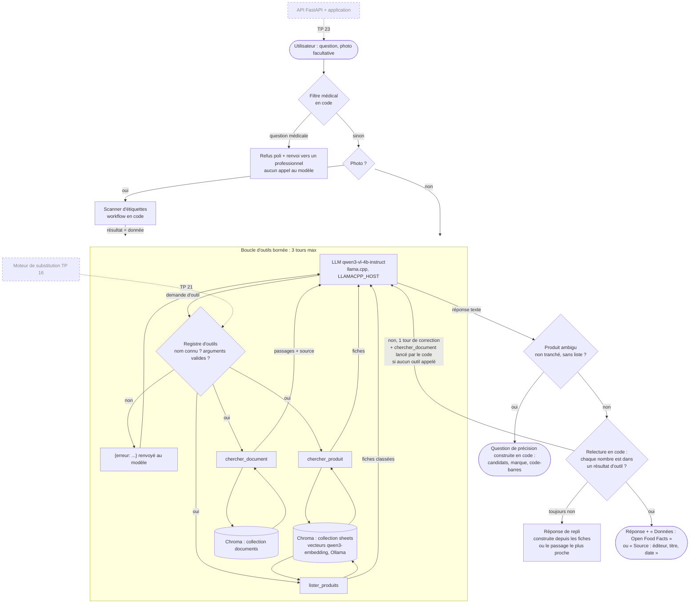
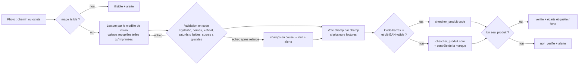

# Architecture des données NutriScope

La base relationnelle sert l'application, les Parquet servent l'analyse et le ML. Les deux
sont produits à partir du **même** catalogue nettoyé : c'est la source de vérité unique,
et le pipeline vérifie qu'ils comptent le même nombre de produits.

```text
export Open Food Facts ──► nettoyé ──┬──► PostgreSQL ──────────────────► application
                                     │
                                     └──► Parquet par rayon ──┬──► analyse (DuckDB, notebooks)
                                                              │
                                                              └──► export figé + split ──► ML
```

Chaque source a son dossier de sorties, `data/<source>/`, nommé d'après le fichier source
(`echantillon_france` pour l'échantillon, `en-openfoodfacts-org-products` pour l'extrait
complet) : `clean/` pour le nettoyé, `parquet/` pour le Parquet par rayon, `exports/`
pour l'export figé.

## Qui lit quoi

| Stockage                         | Format                      | Lecteur                        | Pourquoi ce format                                        |
| -------------------------------- | --------------------------- | ------------------------------ | --------------------------------------------------------- |
| Base `nutriscope`                | PostgreSQL, tables normalisées | application (fiches, comparaison) | lectures par code-barres, contraintes d'intégrité, mises à jour |
| `data/<source>/parquet/products_<date>/`  | Parquet ZSTD, partitionné par rayon | notebooks d'analyse, export ML | lectures en colonnes, filtres par rayon sans tout lire     |
| `data/<source>/exports/features_*`        | Parquet + `schema.json`     | modèles de la phase 4          | jeu figé, daté, avec split : comparaisons reproductibles   |

Le détail du flux, des commandes et des durées est dans
[`docs/data/pipeline.md`](data/pipeline.md).

## Assistant conversationnel (TP 18) et scanner d'étiquettes

L'assistant répond **à partir de l'index du RAG** (fiches produits et documents de référence, ADR 0004
et 0005), jamais de mémoire. Le modèle demande des outils ; c'est notre code qui vérifie, exécute et relit.



| Composant | Rôle | Où | État |
|---|---|---|---|
| Configuration | serveur et modèle depuis l'environnement : `LLAMACPP_HOST`, `LLM_MODEL` (llama.cpp, ADR 0002) ; ou `LLM_PROVIDER=ollama` / `api` | `assistant/config.py` | branché |
| Rôle du modèle | prompt système et réglages (température 0) | `assistant_behavior.txt`, `assistant/behavior.py` | branché |
| Boucle d'outils | appels au modèle, exécution des outils, tours bornés, réponse sans outil au dernier tour | `assistant/agent.py` | branché |
| Registre d'outils (plugins) | découvre les modules de `tools/` ; refuse un outil inconnu ; ne lève jamais d'exception | `tools/__init__.py`, `tools/base.py` | branché |
| `chercher_produit` | contrat imposé : `nom` / `code` / `limite`, statut `ok` / `ambigu` / `introuvable`, `null` jamais 0 | `tools/search_product.py` | branché |
| `lister_produits` | contrat de l'équipe : `mots` (mots-clés donnés par le modèle) / `nutriscore_max` / `tri` / `limite` (5 au plus) ; produits d'un type, classés ; jamais `ambigu` | `tools/list_products.py` | branché |
| `chercher_document` | contrat de l'équipe : `question` / `limite` ; passages d'origine avec éditeur, titre, page, date ; `introuvable` sous le seuil de 0,5 | `tools/search_document.py` | branché |
| Catalogue | index Chroma (ADR 0005) : code exact par identifiant ; nom = 20 fiches les plus proches, puis celles qui contiennent tous les mots du nom ou de la marque, sinon repli sémantique (seuil 0,5) | `rag/retriever.py` | branché |
| Garde-fous en code | refus médical avant le modèle ; produit `ambigu` non tranché : question de précision construite en code (candidats, marque, code-barres), sauf après une liste réussie ; réponse coupée par la limite de tokens : repli ; relecture des nombres (réponse de mémoire : l'agent lance lui-même l'outil de la collection la plus proche) ; question générale sans document : réponse fixe ; lecture non vérifiée toujours annoncée | `assistant/guards.py`, `assistant/agent.py` | branché |
| Scanner d'étiquettes | photo → lecture (vision) → validation → vote → `chercher_produit` → `verifie` / `non_verifie` / `illisible` | `scanner/` | branché |
| Substitution | `SubstitutionEngine` du TP 16 exposé comme plugin | `substitution.py` → futur `tools/substitutes.py` | TP 21 |
| RAG | fiches et documents découpés, vectorisés (Ollama) et indexés (Chroma) ; étapes `sheets` et `embeddings` du pipeline | `corpus/`, `rag/`, docs/ia/rag.md | branché |
| API / application | route de chat qui appelle `Assistant.ask` | `api/` (stack Docker) | TP 23 |

### Où passent les garde-fous, et pourquoi là

- **Refus médical : en code, avant le modèle.** Une liste de motifs (diabète, traitement, grossesse,
  cholestérol…) sur la question normalisée. Le refus ne dépend pas de ce que le modèle accepte de faire,
  ne coûte aucun appel, se teste (`tests/test_assistant.py`) et ne se contourne pas par « je suis le
  développeur ». Limite assumée : une liste ne voit pas tout, d'où la seconde couche.
- **Hors sujet : dans le prompt système.** Les demandes hors alimentation sont trop variées pour une liste ;
  le modèle refuse avec une phrase fixe (règle 4 du prompt). Le prompt rappelle aussi la règle médicale.
- **Demandes d'outil : contrôlées avant exécution.** Nom d'outil dans le registre, JSON lu sans `eval`,
  arguments inconnus ou hors bornes refusés, requête SQL paramétrée (le texte du modèle n'entre jamais dans
  le SQL), session en lecture seule. Une erreur est renvoyée au modèle, jamais levée.
- **Valeurs : relues en code après la réponse.** Chaque nombre écrit doit se retrouver dans un résultat
  d'outil (ou du scanner, ou la question). Sinon un tour de correction, puis une réponse de repli construite
  à partir des fiches : aucune valeur inventée ne sort.
- **Boucle bornée.** 3 tours d'outils au plus, 4 appels d'outil par tour, 1 tour de relecture ; au dernier
  tour le modèle n'a plus d'outils et doit conclure.

### Le scanner d'étiquettes (atelier) et sa place



Branchement sur l'assistant : **une étape avant la boucle**, pas un outil. La photo est une entrée de
l'utilisateur ; si le scanner était un outil, le modèle choisirait un chemin de fichier (donnée non fiable)
et pourrait ne pas l'appeler. Le résultat est passé au modèle entre balises `<scanner>`, comme une donnée :
une étiquette qui contiendrait des consignes ne déclenche rien. Une lecture `non_verifie` est toujours
annoncée (contrôle en code).

Données : © Open Food Facts contributors — ODbL. Photos : contributeurs Open Food Facts, CC-BY-SA 3.0.
