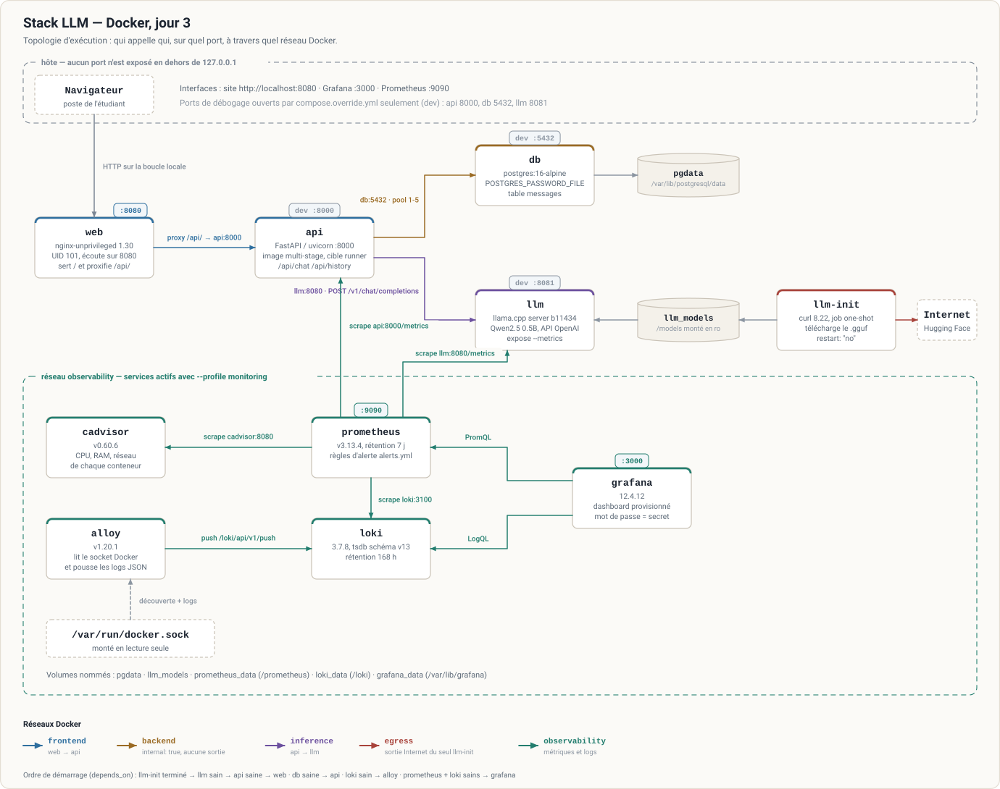
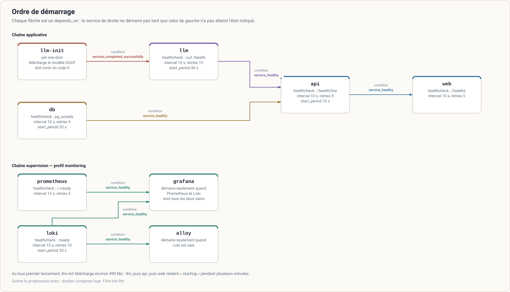
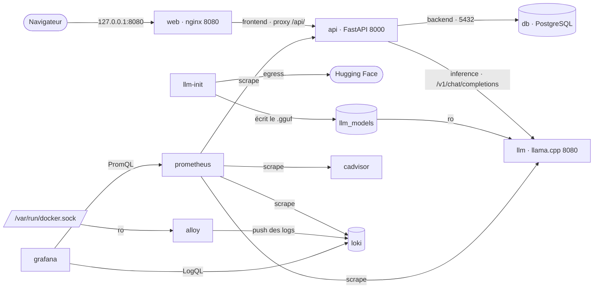
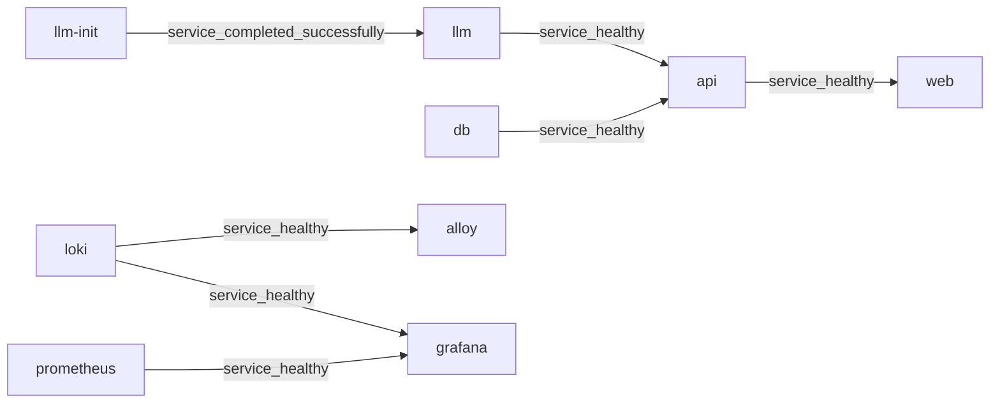

# Architecture de la stack

Deux schémas : **ce qui parle à quoi** une fois la stack démarrée, puis **dans quel ordre** tout cela démarre.

## Topologie d'exécution



### Les interactions, une par une

| Appelant | Appelé | Réseau | Adresse | Détail |
|---|---|---|---|---|
| Navigateur | `web` | *(hôte)* | `http://localhost:8080` | seul port publié en permanence, et uniquement sur `127.0.0.1` |
| `web` | `api` | `frontend` | `http://api:8000` | reverse proxy nginx sur `/api/` ; `resolver 127.0.0.11` pour résoudre le nom au moment de la requête et non au démarrage de nginx |
| `api` | `db` | `backend` | `db:5432` | pool psycopg2 de 1 à 5 connexions ; mot de passe lu dans `/run/secrets/db_password`, jamais dans une variable d'environnement |
| `api` | `llm` | `inference` | `http://llm:8080/v1/chat/completions` | API compatible OpenAI, timeout 120 s ; `GET /health` sert aussi à la sonde de readiness |
| `llm-init` | Hugging Face | `egress` | `huggingface.co` | `curl --fail --location --retry 5 --continue-at -` ; **seul** service à sortir sur Internet |
| `llm-init` | `llm_models` | *(volume)* | `/models` | écrit le fichier `.gguf` ; seul service à y écrire |
| `llm` | `llm_models` | *(volume)* | `/models` | monté en lecture seule (`:ro`) |
| `db` | `pgdata` | *(volume)* | `/var/lib/postgresql/data` | état persistant de la base |
| `prometheus` | `api` | `observability` | `api:8000/metrics` | *scrape* toutes les 15 s (modèle **pull** : c'est Prometheus qui va chercher) |
| `prometheus` | `llm` | `observability` | `llm:8080/metrics` | métriques exposées par l'option `--metrics` de llama.cpp |
| `prometheus` | `cadvisor` | `observability` | `cadvisor:8080/metrics` | CPU, RAM et réseau par conteneur |
| `prometheus` | `loki` | `observability` | `loki:3100/metrics` | Loki se supervise lui-même |
| `alloy` | socket Docker | *(bind `:ro`)* | `/var/run/docker.sock` | découverte des conteneurs et lecture de leurs logs |
| `alloy` | `loki` | `observability` | `loki:3100/loki/api/v1/push` | **push** des logs JSON, à l'inverse de Prometheus |
| `grafana` | `prometheus` | `observability` | `http://prometheus:9090` | datasource provisionnée, uid `prometheus` |
| `grafana` | `loki` | `observability` | `http://loki:3100` | datasource provisionnée, uid `loki` |
| `db-backup` | `db` | `backend` | `db:5432` | `pg_dump` vers `./backups`, profil `backup` uniquement |

### Qui est sur quel réseau

| Réseau | Services | Remarque |
|---|---|---|
| `frontend` | `web`, `api` | la seule porte d'entrée |
| `backend` | `db`, `api`, `db-backup` | `internal: true` en production : la base n'a accès ni à Internet ni à l'hôte |
| `inference` | `llm`, `api` | isole les appels au modèle |
| `egress` | `llm-init` | existe uniquement pour laisser le job one-shot télécharger le modèle |
| `observability` | `api`, `llm`, `prometheus`, `loki`, `alloy`, `cadvisor`, `grafana` | métriques et logs, à l'écart du trafic applicatif |

`api` est le seul service présent sur quatre réseaux : c'est le point de passage obligé entre le front, la base et le modèle.

En développement, `compose.override.yml` repasse `backend` en `internal: false` — sans quoi Docker ne peut pas publier le port 5432 de la base.

### Ports publiés

Tous sur `127.0.0.1`, jamais sur `0.0.0.0`.

| Service | Production | Développement |
|---|---|---|
| `web` | `127.0.0.1:8080` | idem |
| `grafana` | `127.0.0.1:3000` *(profil `monitoring`)* | idem |
| `prometheus` | `127.0.0.1:9090` *(profil `monitoring`)* | idem |
| `api` | — | `127.0.0.1:8000` |
| `db` | — | `127.0.0.1:5432` |
| `llm` | — | `127.0.0.1:8081` |

`/metrics` n'est jamais joignable depuis le navigateur : nginx renvoie un 404 sur `/metrics`, et l'API n'est pas publiée en production.

## Ordre de démarrage



Chaque flèche est un `depends_on` avec une condition. Deux conditions différentes sont à l'œuvre :

- `service_completed_successfully` — `llm` attend que le job `llm-init` se **termine** en code 0. C'est la condition propre aux jobs one-shot.
- `service_healthy` — tous les autres attendent que le **healthcheck** de leur dépendance passe au vert. Sans healthcheck, `depends_on` n'attendrait que la création du conteneur, ce qui ne garantit rien.

Au tout premier lancement, `llm-init` télécharge environ 490 Mo : `llm`, puis `api`, puis `web` restent en `starting` plusieurs minutes. Pour suivre :

```bash
docker compose logs -f llm-init llm
docker compose ps        # colonne STATUS : starting / healthy
```

## Sources modifiables

Les deux images sont des SVG. Pour retoucher les schémas sans éditer le SVG à la main, voici les mêmes graphes en Mermaid.

### Topologie



### Ordre de démarrage


